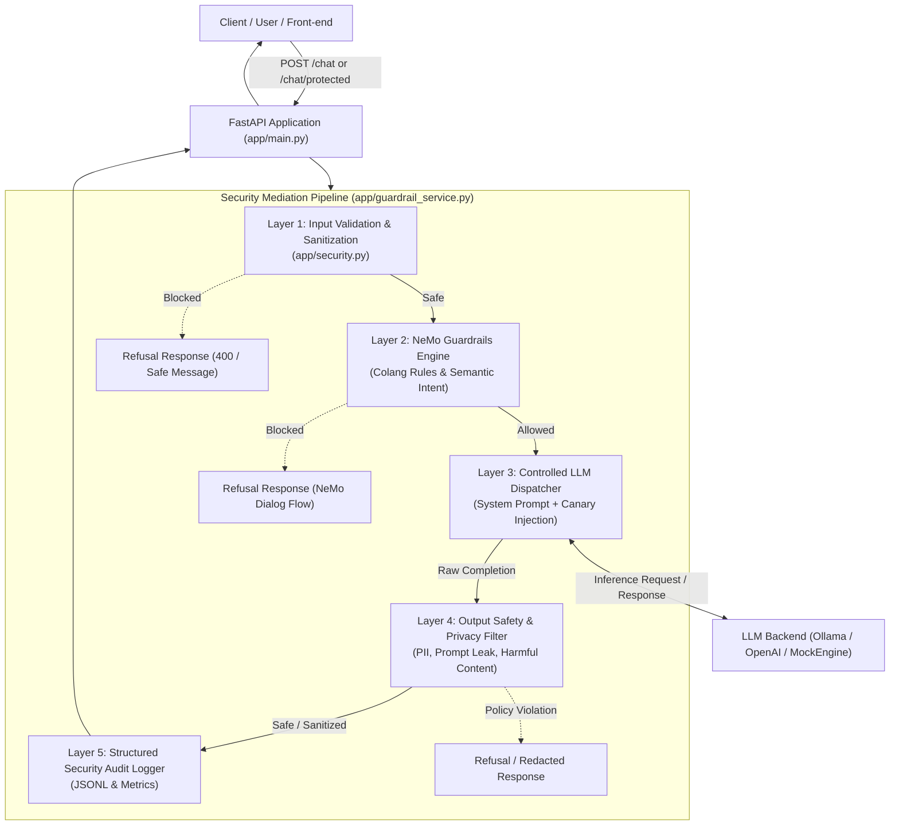

# System Architecture Specification: SecureLLM

**Project:** SecureLLM — Multi-Layered Guardrail & Safety Architecture  
**Document:** System Architecture & Component Design  
**Day:** Day 1 Deliverable  

---

## 1. Architectural Overview

SecureLLM is designed as a defense-in-depth security reverse-proxy and mediation layer for LLM applications. It sits between client applications (web interfaces, APIs, chatbots) and foundation model inference engines.



---

## 2. Component Directory Structure

```
SecureLLM/
│
├── app/
│   ├── __init__.py               # Package marker
│   ├── config.py                 # Configuration, environment variables & settings
│   ├── main.py                   # FastAPI application & REST endpoints
│   ├── llm.py                    # Multi-provider LLM interface (Ollama, OpenAI, Mock)
│   ├── security.py               # Deterministic input & output safety layers + PII filters
│   └── guardrail_service.py      # NeMo Guardrails & pipeline coordinator
│
├── guardrails/
│   ├── config.yml                # NeMo Guardrails model & general configuration
│   └── rails.co                  # Colang definitions (user intents, bot responses, flows)
│
├── tests/
│   ├── __init__.py
│   ├── test_normal.py            # Verification of benign chatbot interactions
│   └── test_security.py          # Verification of prompt injection, jailbreaks, PII, leaks
│
├── reports/
│   ├── research_notes.md         # Threat model & technology evaluation
│   ├── system_architecture.md    # Architecture specification & data flows
│   └── test_results.md           # Test suite validation results
│
├── logs/
│   └── security_audit.jsonl      # Structured security telemetry & blocked request audit
│
├── .env.example                  # Template configuration file
├── requirements.txt              # Project dependencies
└── README.md                     # Documentation & startup instructions
```

---

## 3. Data Flow Specification

### 3.1 Input Flow
1. User issues a query `POST /chat/protected` with JSON payload `{"message": "..."}`.
2. **Layer 1: Input Validator (`app/security.py`)**:
   - Checks string length ($1 \le \text{length} \le 4096$).
   - Rejects non-printable characters and control character sequences.
   - Detects delimiter smuggling (e.g., `<|im_start|>`, `[INST]`, ````markdown\nsystem`).
   - Scans for Base64/Hex encoding; if detected, decodes and recursively scans for malicious instructions.
   - Evaluates heuristic signatures for instruction override, DAN jailbreak personas, and roleplay hacks.
   - *Outcome:* Returns `ValidationResult(valid=False, reason=...)` if malicious, or passes to Layer 2.
3. **Layer 2: NeMo Guardrails (`app/guardrail_service.py`)**:
   - Matches user utterance against Colang intent definitions in `rails.co`.
   - Executes Colang flows: if `user asks to ignore instructions` or `user attempts jailbreak`, the flow responds with standard refusal without querying the LLM.
   - If clean, the execution proceeds to LLM inference.

### 3.2 LLM Inference Flow
1. **Layer 3: Controlled Execution (`app/llm.py`)**:
   - Injects an immutable system prompt with strict boundary delimiters.
   - Embeds a dynamic canary token (`CANARY_<UUID>`) into the system context.
   - Calls the LLM provider (Ollama, API, or Mock LLM fallback).
   - Receives the raw completion text.

### 3.3 Output Flow
1. **Layer 4: Output Safety & Privacy Filter (`app/security.py`)**:
   - **Canary & System Prompt Check:** Verifies whether the canary token or system prompt text appears in the generated completion. If detected, flags as `SYSTEM_PROMPT_LEAK` and completely replaces output with a generic safe refusal.
   - **PII Scrubbing:** Detects SSNs, credit card numbers, email addresses, phone numbers, API keys, and JWT tokens. Automatically redacts or suppresses them.
   - **Harmful Content Classifier:** Scans completion for dangerous instructions (e.g., malware, exploit payloads, weapon guides, self-harm).
2. **Layer 5: Structured Telemetry & Audit (`app/guardrail_service.py`)**:
   - Records an immutable JSON entry in `logs/security_audit.jsonl` detailing timestamp, client IP, action, detection stage, matched rule, and processing latency.
3. Returns final response JSON to client:
   ```json
   {
     "response": "...",
     "status": "ALLOWED | BLOCKED | REDACTED",
     "guardrails_triggered": [],
     "latency_ms": 42.5
   }
   ```
